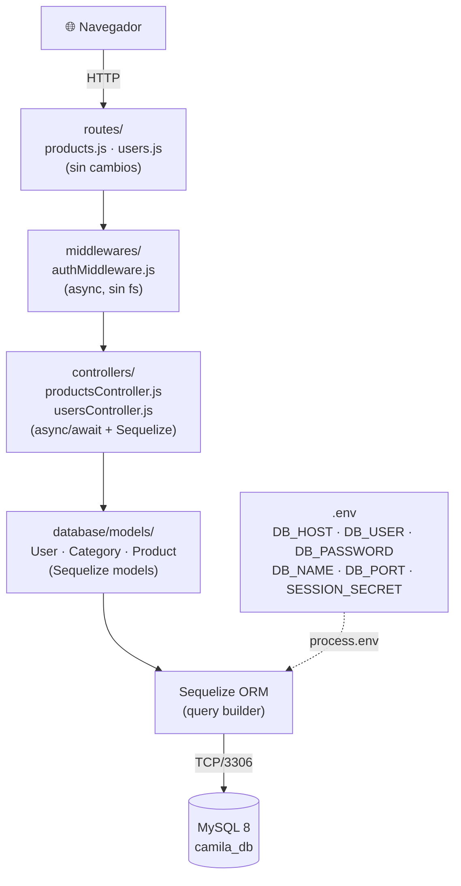
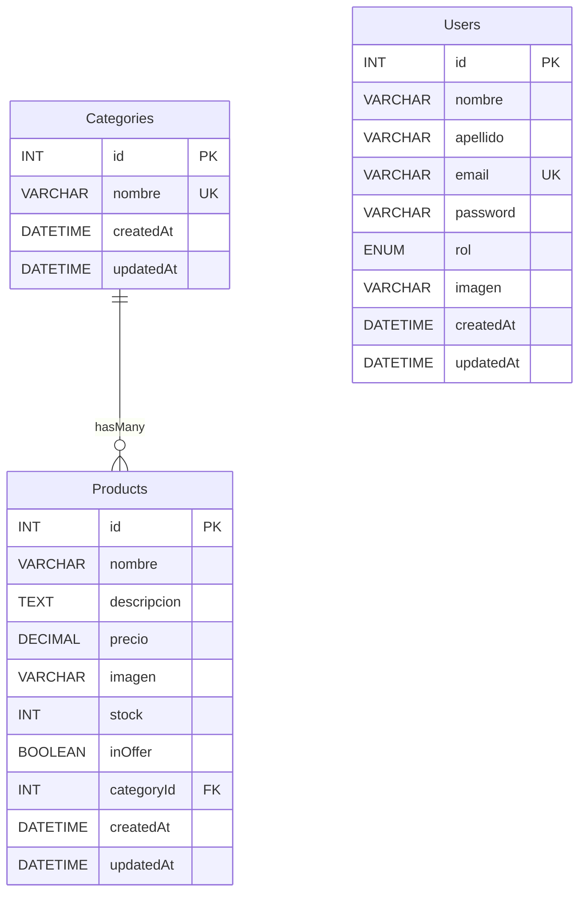

# Design Document — Sprint 6: Migración a Sequelize ORM

## Overview

Este sprint migra la capa de persistencia del proyecto "Camila Manrique" desde archivos JSON estáticos (`productsDataBase.json`, `users.json`) hacia una base de datos relacional MySQL gestionada a través de Sequelize ORM. La migración es **zero-breaking-change** desde la perspectiva de las vistas EJS y las rutas HTTP: ninguna URL cambia, ningún nombre de variable en las vistas cambia, y el comportamiento externo de la aplicación se mantiene idéntico.

El stack técnico final:

- **Runtime**: Node.js + Express 5 (CommonJS)
- **Plantillas**: EJS
- **ORM**: Sequelize 6 con driver `mysql2`
- **Base de datos**: MySQL 8
- **CLI**: `sequelize-cli` para migraciones y seeders
- **Variables de entorno**: `dotenv`

---

## Architecture

### Diagrama de capas



### Diagrama de base de datos (ERD)



### Flujo de datos antes vs. después

| Operación | Antes (JSON) | Después (Sequelize) |
|---|---|---|
| Listar productos | `fs.readFileSync` → `JSON.parse` | `await Product.findAll()` |
| Buscar por ID | `array.find(p => p.id === id)` | `await Product.findByPk(id)` |
| Crear | `array.push` → `fs.writeFileSync` | `await Product.create(data)` |
| Actualizar | `array[index] = {...}` → write | `await product.update(data)` |
| Eliminar | `array.filter` → write | `await Product.destroy({ where: { id } })` |
| Login | `users.find` → `bcrypt.compare` | `await User.findOne({ where: { email } })` → `bcrypt.compare` |
| RememberMe | `fs.readFileSync` → `users.find` | `await User.findOne({ where: { email } })` |

---

## Components and Interfaces

### Estructura de archivos nueva

```
proyecto/
├── .env                          ← NO commiteado (en .gitignore)
├── .env.example                  ← Plantilla commiteada
├── structure.sql                 ← Entregable académico: esquema
├── data.sql                      ← Entregable académico: datos
├── app.js                        ← Agrega require('dotenv').config()
├── package.json                  ← Agrega sequelize, sequelize-cli, mysql2, dotenv
│
├── database/
│   ├── config/
│   │   └── config.js             ← Conexión leída de process.env
│   ├── models/
│   │   ├── index.js              ← Instancia Sequelize + exporta modelos
│   │   ├── User.js
│   │   ├── Category.js
│   │   └── Product.js
│   ├── migrations/
│   │   ├── YYYYMMDD-create-categories.js
│   │   ├── YYYYMMDD-create-users.js
│   │   └── YYYYMMDD-create-products.js
│   └── seeders/
│       ├── YYYYMMDD-demo-categories.js
│       └── YYYYMMDD-demo-products.js
│
├── controllers/
│   ├── productsController.js     ← Reemplaza fs/JSON por Sequelize
│   └── usersController.js        ← Reemplaza fs/JSON por Sequelize
├── middlewares/
│   └── authMiddleware.js         ← Reemplaza readUsers() por User.findOne()
├── routes/
│   ├── products.js               ← SIN CAMBIOS
│   └── users.js                  ← SIN CAMBIOS
└── retro.md                      ← Agrega sección Sprint 6
```

### `.env.example`

```dotenv
# Base de datos
DB_HOST=localhost
DB_PORT=3306
DB_USER=root
DB_PASSWORD=tu_password_aqui
DB_NAME=camila_db

# Sesión Express
SESSION_SECRET=camila_manrique_secret_2026
```

### `database/config/config.js`

```js
// Carga dotenv solo si el archivo .env existe (entorno local)
require('dotenv').config();

const base = {
    host:     process.env.DB_HOST     || (() => { throw new Error('DB_HOST no definido en .env'); })(),
    port:     process.env.DB_PORT     || 3306,
    username: process.env.DB_USER     || (() => { throw new Error('DB_USER no definido en .env'); })(),
    password: process.env.DB_PASSWORD || '',
    database: process.env.DB_NAME     || (() => { throw new Error('DB_NAME no definido en .env'); })(),
    dialect:  'mysql',
    logging:  false,
};

module.exports = {
    development: base,
    test:        base,
    production:  base,
};
```

> **Decisión de diseño**: la misma configuración se usa para los tres entornos leyendo siempre de `process.env`. Esto simplifica el setup académico y garantiza que nunca haya credenciales hardcodeadas. En un proyecto productivo real, se separarían los entornos.

### `database/models/index.js`

```js
'use strict';
require('dotenv').config();
const { Sequelize } = require('sequelize');
const config        = require('../config/config');
const env           = process.env.NODE_ENV || 'development';
const dbConfig      = config[env];

const sequelize = new Sequelize(
    dbConfig.database,
    dbConfig.username,
    dbConfig.password,
    dbConfig
);

const User     = require('./User')(sequelize);
const Category = require('./Category')(sequelize);
const Product  = require('./Product')(sequelize);

// Asociaciones
Category.hasMany(Product,  { foreignKey: 'categoryId', as: 'products' });
Product.belongsTo(Category, { foreignKey: 'categoryId', as: 'category' });

module.exports = { sequelize, Sequelize, User, Category, Product };
```

### `app.js` — cambios mínimos

```js
// Agregar al inicio del archivo, antes de cualquier require de modelos
require('dotenv').config();

// Reemplazar el secret hardcodeado:
app.use(session({
    secret: process.env.SESSION_SECRET || 'fallback_secret',
    // ... resto igual
}));
```

---

## Data Models

### User (`database/models/User.js`)

```js
'use strict';
const { DataTypes } = require('sequelize');

module.exports = (sequelize) => {
    const User = sequelize.define('User', {
        nombre:   { type: DataTypes.STRING, allowNull: false },
        apellido: { type: DataTypes.STRING, allowNull: false },
        email:    { type: DataTypes.STRING, allowNull: false, unique: true },
        password: { type: DataTypes.STRING, allowNull: false },
        rol:      {
            type:         DataTypes.ENUM('admin', 'user'),
            allowNull:    false,
            defaultValue: 'user'
        },
        imagen:   { type: DataTypes.STRING }
    }, {
        tableName:  'Users',
        timestamps: true
    });

    return User;
};
```

**Campos de sesión**: al guardar en `req.session.user`, se usan:
```js
req.session.user = {
    id:     user.id,
    nombre: user.nombre,   // las vistas usan sessionUser.nombre
    email:  user.email,
    image:  user.imagen    // las vistas usan sessionUser.image (campo "image")
};
```

> **Nota de compatibilidad**: el modelo almacena `imagen` (español, consistente con los demás campos), pero al guardar en sesión se mapea a `image` para mantener compatibilidad con las vistas EJS y el código de `usersController.js` existente.

### Category (`database/models/Category.js`)

```js
'use strict';
const { DataTypes } = require('sequelize');

module.exports = (sequelize) => {
    const Category = sequelize.define('Category', {
        nombre: { type: DataTypes.STRING, allowNull: false, unique: true }
    }, {
        tableName:  'Categories',
        timestamps: true
    });

    return Category;
};
```

### Product (`database/models/Product.js`)

```js
'use strict';
const { DataTypes } = require('sequelize');

module.exports = (sequelize) => {
    const Product = sequelize.define('Product', {
        nombre:      { type: DataTypes.STRING,       allowNull: false },
        descripcion: { type: DataTypes.TEXT },
        precio:      { type: DataTypes.DECIMAL(10, 2), allowNull: false },
        imagen:      { type: DataTypes.STRING },
        stock:       { type: DataTypes.INTEGER,      defaultValue: 0 },
        inOffer:     { type: DataTypes.BOOLEAN,      defaultValue: false },
        categoryId:  {
            type:       DataTypes.INTEGER,
            references: { model: 'Categories', key: 'id' }
        }
    }, {
        tableName:  'Products',
        timestamps: true
    });

    return Product;
};
```

### Migraciones

Las migraciones se generan con `sequelize-cli` y siguen el orden de dependencias:

1. **`create-categories`** → sin FKs, puede crearse primero
2. **`create-users`** → sin FKs, independiente
3. **`create-products`** → tiene FK `categoryId → Categories.id`

Ejemplo de migración para Products (los campos son los mismos que el modelo):
```js
// database/migrations/YYYYMMDD-create-products.js
'use strict';
module.exports = {
    async up(queryInterface, Sequelize) {
        await queryInterface.createTable('Products', {
            id:          { type: Sequelize.INTEGER, primaryKey: true, autoIncrement: true },
            nombre:      { type: Sequelize.STRING,  allowNull: false },
            descripcion: { type: Sequelize.TEXT },
            precio:      { type: Sequelize.DECIMAL(10, 2), allowNull: false },
            imagen:      { type: Sequelize.STRING },
            stock:       { type: Sequelize.INTEGER, defaultValue: 0 },
            inOffer:     { type: Sequelize.BOOLEAN, defaultValue: false },
            categoryId:  {
                type:       Sequelize.INTEGER,
                references: { model: 'Categories', key: 'id' },
                onUpdate:   'CASCADE',
                onDelete:   'SET NULL'
            },
            createdAt:   { type: Sequelize.DATE, allowNull: false },
            updatedAt:   { type: Sequelize.DATE, allowNull: false }
        });
    },
    async down(queryInterface) {
        await queryInterface.dropTable('Products');
    }
};
```

### Scripts SQL entregables

**`structure.sql`** — Orden de creación:
```sql
CREATE DATABASE IF NOT EXISTS camila_db
  CHARACTER SET utf8mb4 COLLATE utf8mb4_unicode_ci;
USE camila_db;

CREATE TABLE IF NOT EXISTS Categories ( ... );  -- primero (sin FK)
CREATE TABLE IF NOT EXISTS Users ( ... );       -- segundo (sin FK)
CREATE TABLE IF NOT EXISTS Products ( ... );    -- tercero (FK -> Categories)
```

**`data.sql`** — Datos de prueba:
- Mínimo 3 categorías: `Tote`, `Bandolera`, `Mini Bag`, `Morral`, `Clutch`
- Mínimo 5 productos coherentes con marroquinería colombiana
- Los precios en COP (ej. 285000, 195000, 165000)

---

## Correctness Properties

*Una propiedad es una característica o comportamiento que debe cumplirse en todas las ejecuciones válidas del sistema — esencialmente, una afirmación formal sobre lo que el software debe hacer. Las propiedades sirven como puente entre especificaciones legibles por humanos y garantías de correctitud verificables automáticamente.*

### Evaluación de aplicabilidad de PBT

Este feature involucra:
- Lógica de negocio pura en controladores (transformaciones de datos, validaciones)
- Modelos ORM con restricciones y asociaciones
- Middleware de autenticación con lógica condicional

PBT **sí aplica** para la capa de modelos y controladores. No aplica para migraciones (infraestructura), scripts SQL (entregables estáticos), ni la retrospectiva (documentación).

---

### Property 1: Creación de usuario preserva campos y aplica valor por defecto de rol

*Para cualquier* conjunto de datos válidos de usuario (nombre, apellido, email único, password), al crear un `User` mediante `User.create(data)` sin especificar `rol`, el registro resultante debe contener exactamente los campos especificados y el campo `rol` debe tener el valor `'user'`.

**Validates: Requirements 3.1, 3.3**

---

### Property 2: La restricción UNIQUE de email se cumple siempre

*Para cualquier* dirección de email, si ya existe un `User` con ese email en la base de datos, un segundo intento de `User.create` con el mismo email debe lanzar un error de validación único (`SequelizeUniqueConstraintError`), sin importar el resto de los campos del nuevo usuario. Esto aplica igualmente desde la capa de modelo y desde el `UsersController.store`.

**Validates: Requirements 3.2, 9.1**

---

### Property 3: CRUD completo de productos es consistente con la base de datos

*Para cualquier* conjunto válido de datos de producto (nombre, precio, categoryId existente), se debe cumplir:
- Tras `Product.create(data)`, `Product.findAll()` incluye el nuevo producto.
- Tras `product.update(newData)`, `Product.findByPk(id)` retorna los datos actualizados.
- Tras `Product.destroy({ where: { id } })`, `Product.findByPk(id)` retorna `null`.

**Validates: Requirements 8.1, 8.4, 8.5, 8.6**

---

### Property 4: Producto no encontrado siempre devuelve HTTP 404

*Para cualquier* valor de `id` que no exista en la tabla `Products`, una solicitud `GET /products/:id` debe retornar un código de estado HTTP 404 (sin importar el valor numérico del `id`).

**Validates: Requirements 8.3**

---

### Property 5: La búsqueda con Op.like retorna solo productos coincidentes

*Para cualquier* término de búsqueda `s` y cualquier conjunto de productos en la base de datos, `Product.findAll({ where: { [Op.or]: [{ nombre: { [Op.like]: '%s%' } }, { descripcion: { [Op.like]: '%s%' } }] } })` debe retornar exactamente los productos cuyo `nombre` o `descripcion` contiene `s` como subcadena — ni más ni menos.

**Validates: Requirements 8.7**

---

### Property 6: El password nunca se almacena en texto plano

*Para cualquier* contraseña `p` ingresada durante el registro, el campo `password` del `User` creado en la base de datos nunca debe ser igual a `p`. El valor almacenado debe ser verificable mediante `bcrypt.compare(p, storedHash) === true` y debe comenzar con el prefijo `$2b$` de bcrypt.

**Validates: Requirements 9.2**

---

### Property 7: El login es correcto si y solo si las credenciales son válidas

*Para cualquier* usuario registrado con email `e` y contraseña `p`:
- `POST /users/login` con `{ email: e, password: p }` debe resultar en una redirección exitosa con sesión activa.
- `POST /users/login` con `{ email: e, password: p' }` donde `p' ≠ p` debe renderizar la vista de login con el mensaje `'Correo o contraseña incorrectos.'` y sin sesión activa.
- `POST /users/login` con un email que no existe debe renderizar la vista de login con el mismo mensaje de error.

**Validates: Requirements 9.3, 9.4**

---

### Property 8: La sesión post-registro contiene los campos requeridos

*Para cualquier* registro exitoso de usuario (datos válidos, email único), la sesión `req.session.user` debe contener exactamente los campos `id`, `nombre`, `email` e `image` con los valores correspondientes al usuario creado.

**Validates: Requirements 9.5**

---

### Property 9: RememberMe establece sesión si y solo si el usuario existe en BD

*Para cualquier* valor del cookie `rememberUser`:
- Si el email del cookie corresponde a un usuario en la base de datos, `rememberMe` debe establecer `req.session.user` con los datos de ese usuario.
- Si el email del cookie no existe en la base de datos, `rememberMe` debe llamar a `next()` sin modificar `req.session`.

**Validates: Requirements 10.1, 10.2**

---

### Property 10: La asociación Category-Product se resuelve correctamente en consultas

*Para cualquier* producto con `categoryId` válido, `Product.findByPk(id, { include: [{ model: Category, as: 'category' }] })` debe retornar el objeto con el campo `category` anidado conteniendo el `id` y `nombre` de la categoría correspondiente — y no de otra categoría.

**Validates: Requirements 4.2, 5.2, 5.3**

---

## Error Handling

### Errores de conexión a la base de datos

El módulo `database/models/index.js` crea la instancia de Sequelize al importarse. Si las variables de entorno no están definidas, `config.js` lanza un `Error` descriptivo antes de intentar cualquier conexión.

Se recomienda agregar un bloque de autenticación en `app.js`:

```js
const { sequelize } = require('./database/models');

sequelize.authenticate()
    .then(() => console.log('✅ Conexión a MySQL establecida.'))
    .catch(err => {
        console.error('❌ No se pudo conectar a la base de datos:', err.message);
        process.exit(1); // falla rápido si no hay DB
    });
```

### Errores en controladores

Todos los métodos de controlador deben usar `try/catch` con `async/await`:

```js
async index(req, res) {
    try {
        const products = await Product.findAll({ include: [{ model: Category, as: 'category' }] });
        res.render('products/index', { products });
    } catch (err) {
        console.error('Error al listar productos:', err);
        res.status(500).send('Error interno del servidor.');
    }
},
```

### Errores de unicidad (email duplicado)

En `UsersController.store`, verificar **antes** del `User.create` con `User.findOne`. Si por alguna condición de carrera llega igual un `SequelizeUniqueConstraintError`, capturarlo en el `catch` y volver a renderizar el formulario con error.

### Tipos de error Sequelize relevantes

| Error | Situación | Manejo |
|---|---|---|
| `SequelizeConnectionError` | DB inaccesible | Falla rápido en startup |
| `SequelizeUniqueConstraintError` | Email duplicado | Renderizar form con error |
| `SequelizeValidationError` | Campo inválido (null, enum) | Renderizar form con error |
| `null` de `findByPk` | Recurso no encontrado | Responder 404 |

---

## Testing Strategy

### Decisión sobre PBT

Las propiedades identificadas aplican a la lógica de los **modelos Sequelize** y los **controladores**. La estrategia de testing tiene dos capas complementarias:

1. **Tests unitarios/de integración** — para casos específicos, configuraciones y comportamientos de infraestructura
2. **Tests de propiedades (PBT)** — para las 10 propiedades de correctitud definidas arriba

### Librería de PBT

Para el stack Node.js/CommonJS de este proyecto se usará **[fast-check](https://fast-check.dev/)** (la librería PBT más madura del ecosistema JavaScript).

```bash
npm install --save-dev fast-check
```

Configuración mínima: **100 ejecuciones por propiedad** (default de fast-check).

### Convención de tags en tests

Cada test de propiedad debe llevar un comentario con la referencia al documento de diseño:

```js
// Feature: sprint-6-sequelize-migration, Property 2: La restricción UNIQUE de email se cumple siempre
test('email unique constraint', async () => { ... });
```

### Tests unitarios — casos específicos

| Módulo | Qué testear | Tipo |
|---|---|---|
| `config.js` | Lanza error si `DB_NAME` no definida | Ejemplo |
| `config.js` | Usa valores de `process.env` | Ejemplo |
| `structure.sql` | Contiene `CREATE DATABASE IF NOT EXISTS` | Ejemplo |
| `data.sql` | Contiene ≥ 3 categorías y ≥ 5 productos | Ejemplo |
| Rutas products | URLs conservadas sin cambios | Smoke |
| Rutas users | URLs conservadas sin cambios | Smoke |
| `.gitignore` | Contiene `.env`, `node_modules/` | Smoke |

### Tests de propiedades — implementación

Cada propiedad se implementa como un **único test PBT** con `fast-check`:

```js
const fc = require('fast-check');
const { User } = require('../../database/models');

// Feature: sprint-6-sequelize-migration, Property 1: Creación de usuario preserva campos y aplica valor por defecto de rol
test('User.create sin rol asigna "user" por defecto', async () => {
    await fc.assert(
        fc.asyncProperty(
            fc.record({
                nombre:   fc.string({ minLength: 1 }),
                apellido: fc.string({ minLength: 1 }),
                email:    fc.emailAddress(),
                password: fc.string({ minLength: 6 })
                // sin campo 'rol'
            }),
            async (data) => {
                const user = await User.create(data);
                expect(user.rol).toBe('user');
                await user.destroy();
            }
        ),
        { numRuns: 100 }
    );
});
```

### Tests de integración

| Test | Tipo |
|---|---|
| `npx sequelize-cli db:migrate` crea las 3 tablas | Integration |
| `npx sequelize-cli db:migrate:undo:all` elimina las 3 tablas | Integration |
| Ejecutar `structure.sql` + `data.sql` permite conexión | Integration |
| `sequelize.authenticate()` conecta correctamente con `.env` válido | Integration |

### Tests de humo (Smoke)

| Test | Tipo |
|---|---|
| `.gitignore` incluye `.env` | Smoke |
| `package.json` incluye `sequelize`, `sequelize-cli`, `mysql2`, `dotenv` | Smoke |
| Existen los archivos en `database/config/`, `database/models/`, `database/migrations/`, `database/seeders/` | Smoke |
| `routes/products.js` y `routes/users.js` sin cambios | Smoke |

### Herramienta de test recomendada

**Jest** es la elección natural para este stack:

```bash
npm install --save-dev jest
```

```json
// package.json
"scripts": {
    "test": "jest --testEnvironment node"
}
```

Los tests de integración requieren una base de datos MySQL de prueba. Se recomienda usar una base de datos separada (`camila_test`) definida en `.env.test` y configurada en el entorno `test` del `config.js`.
